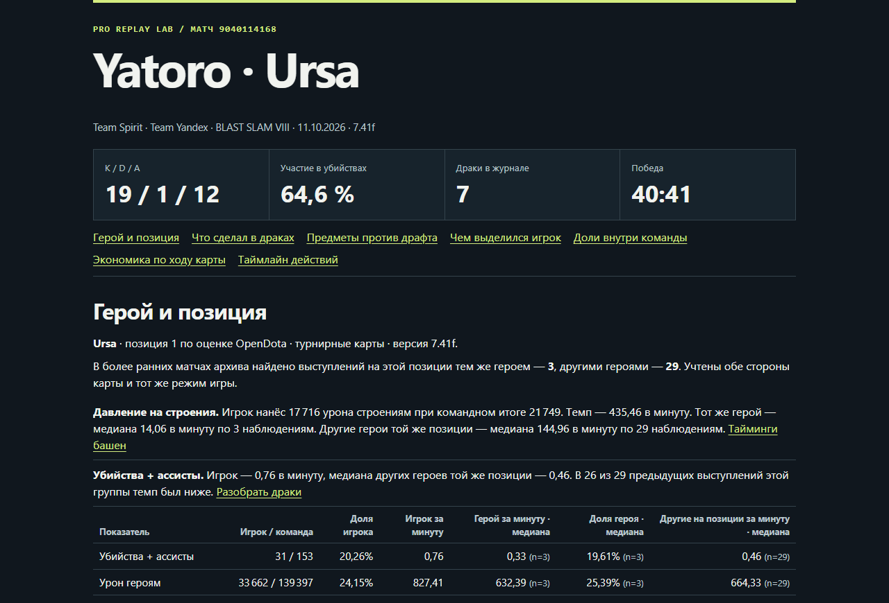

# Pro Replay Lab

Локальный анализатор матчей Dota 2 на Python. Выбери про-игрока и проверь гипотезу о его действиях по игровым таймингам. Каждое найденное совпадение ведёт в матч. Для первой версии выбран Dota 2. Демо посвящено Yatoro.

## Вклад игрока за одну карту

В [выборке из 120 рейтинговых матчей](examples/ranked-impact.html) самый высокий индекс получил Lion — 45,4% в проигранной карте. Все 144 единицы командного урона строениям принадлежали ему. Самый высокий индекс у победителей составил 43,1%, самый низкий — 7,8%. В отчёте можно раскрыть все десять индексов каждой карты.

Открой готовый [разбор Yatoro на Ursa](examples/yatoro-ursa.html) из скачанного проекта в браузере. В игре против Team Yandex Yatoro нанёс **17 716 из 21 749 единиц урона строениям (81,5%)**. Его индекс вклада в команде составил **30,3%**. Blink Dagger появился на **16:30**, а на **16:39** Yatoro убил Razor. [Журнал карты](https://www.opendota.com/matches/9040114168)



Для новой карты укажи игрока и ID матча. Первая команда загружает официальный календарь версий игры, вторая берёт карточку из локального архива или запрашивает её у OpenDota.

```powershell
py -m pro_replay patches
py -m pro_replay match 321580662 9040114168 --out ursa.html
Start-Process .\ursa.html
```

**Вклад в команду.** В отчёте есть исходные значения игрока и пяти союзников в сумме, доли и веса шести показателей. Вес убийств и ассистов — 25, урона героям — 25, урона строениям — 20, контроля — 15, установки и снятия Observer Ward — 10, лечения героев — 5. Индекс — взвешенное среднее долей. Нулевой командный итог или пропуск у любого союзника исключает показатель для всех пяти. При трёх доступных показателях и более сумма индексов команды до округления равна 100%. Веса выбраны вручную. Для причинной оценки влияния на победу данных этого индекса недостаточно.

**Чем выделился игрок.** Для найденных последовательностей отчёт проверяет действия остальных четырёх союзников. Утверждение «единственный из пяти» требует сведений обо всех четырёх. Частота эпизода и медианы таймингов предметов берутся из более ранних карт этого игрока на том же герое и патче. Рядом указан размер выборки. На свежей установке история для сравнения появится после `sync`.

**Ход карты.** Доступны экономика по десятиминутным отметкам, убийства, смерти, лечение, урон и изменение золота в командных драках. Таймлайн фильтруется по покупкам, боевым действиям, объектам и вардам. Убийство Roshan отмечается как командное событие. Подбор Aegis привязывается к конкретному игроку.

## Проверка на 100 турнирных картах Yatoro

Выборка от 10 июля до 16 ноября 2026 года (UTC). Карточки и журналы получены из OpenDota. Версия определена по времени начала карты и календарю публикаций Valve. Получилось 8 карт на 7.41d, 29 на 7.41e и 63 на 7.41f. Ссылки на Dotabuff в отчётах открывают карту для ручной сверки. [Календарь Valve](https://www.dota2.com/patches)

[Скачать 100 готовых разборов и базу для обучения](examples/yatoro-100-reports.zip). Распакуй ZIP целиком и открой `yatoro-100.html`. Поиск находит карту по герою, турниру или ID. Чтобы повторить обучение офлайн, из папки с исходниками выполни `py -m pro_replay --db "путь/к/yatoro-100.sqlite" train 321580662`.

На 29 картах журнал содержит покупку Blink Dagger. В 10 из этих 29 карт Yatoro сделал убийство в следующие 120 секунд. Модель прогнозировала первый отслеживаемый предмет после 10:00 и до 30:00 включительно. Для обучения использованы 80 ранних карт и 17 классов предметов. Все три прогноза проверены на одних и тех же 20 более поздних картах.

| Прогноз | Верно на 20 картах | Точность |
| --- | ---: | ---: |
| Логистическая регрессия с версией Valve | 12 | 60% |
| Самый частый предмет Yatoro на выбранном герое | 12 | 60% |
| Самый частый предмет Yatoro на всех героях (Manta Style) | 1 | 5% |

Модель с одним числовым ID патча OpenDota вместо дополнительной версии Valve дала 10 из 20. Такой размер проверки позволяет сравнить эти прогнозы на выбранных картах. Результат по другим игрокам и будущим патчам потребует отдельной проверки.

Для воспроизведения используй отдельный архив и [точный список ID](examples/yatoro-100-ids.txt). Итоговая страница даст доступ к полному отчёту каждой из ста карт.

```powershell
$matchIds = Get-Content .\examples\yatoro-100-ids.txt
py -m pro_replay --db data/yatoro-100.sqlite patches
py -m pro_replay --db data/yatoro-100.sqlite sync 321580662 --match @matchIds
py -m pro_replay --db data/yatoro-100.sqlite report 321580662 --details --out yatoro-100.html
py -m pro_replay --db data/yatoro-100.sqlite find 321580662 item:blink kill --within 120
py -m pro_replay --db data/yatoro-100.sqlite train 321580662 --out data/yatoro-model.json
```

## Первый запуск

Требуется Python 3.10 или новее. Зависимости входят в стандартную библиотеку. В Windows открой PowerShell в папке проекта. В macOS и Linux замени `py` на `python3`.

```powershell
py -m pro_replay demo
py -m pro_replay find demo tower item:manta
```

Открой созданный файл `yatoro.html`. Готовый отчёт также лежит в папке `examples`. Демо работает без интернета. В него входят 11 подтверждённых событий двух карт Team Spirit против TEAM VISION. В каждой карте герою Yatoro засчитали башню до Manta Style. Таблица показывает самое раннее такое совпадение среди выбранных событий.

| Герой | Башня | Manta Style | Интервал |
| --- | --- | --- | --- |
| Shadow Fiend | 11:51 | 15:59 | 4:08 |
| Terrorblade | 09:12 | 14:32 | 5:20 |

Если задать `--within 200`, на Terrorblade найдётся другая пара. Башня на 11:17 и Manta на 14:32 укладываются в 195 секунд. Двух карт достаточно для проверки запроса. Чтобы оценить привычку игрока, собери более широкую выборку и задай фильтры по герою и патчу. Ссылки и происхождение полей приведены в [источниках](examples/SOURCES.md).

## Свои запросы к архиву

```powershell
py -m pro_replay sync 321580662 --limit 20
py -m pro_replay report 321580662 --out yatoro-live.html
py -m pro_replay find 321580662 item:blink kill --within 120
py -m pro_replay find 321580662 observer kill --within 90
py -m pro_replay find 321580662 tower item:manta --hero 109
```

Последние три команды находят убийство в течение двух минут после покупки Blink Dagger, убийство в течение 90 секунд после установки Observer Ward и башню до Manta на Terrorblade. Совпадение по времени показывает порядок событий. Например, второй запрос сам по себе не доказывает, что поставленный вард раскрыл жертву.

Поддерживаются `kill`, `tower`, `observer`, `sentry` и `item:<внутренний ключ>`. Примеры ключей — `blink`, `black_king_bar`, `manta`. В полном журнале можно искать любой записанный предмет. Отчёт и модель используют ограниченный список в `pro_replay/analysis.py`. Событие `tower` означает последний удар именно героя игрока по башне и может включать денай. В демо обе показанные башни принадлежали противнику. При отсутствии атрибуции журнал башен помечается неполным. Команды `find`, `report` и `train` принимают `--patch` с числовым ID OpenDota и `--hero` с ID героя.

`find` выводит по одной паре на матч. Выбирается самое раннее начальное событие с подходящим продолжением. Действия в одну секунду не имеют определённого порядка. В отчёте три группы: совпадение подтверждено, журналы доступны и совпадения нет, данных недостаточно. Положительное совпадение можно найти даже в неполной выписке.

## Загрузка данных

```powershell
py -m pro_replay sync Yatoro --all
py -m pro_replay sync 321580662 --match 8960577698 8960762254
```

Первая команда ищет игрока в `/proPlayers`, затем читает все его доступные турнирные матчи из профессионального Data Explorer постранично. Фильтр по account ID работает и после смены команды. Ключ `--all` относится к записям, которые индексирует OpenDota для этого аккаунта. Публичность турнира, доступность карточки и наличие разобранного реплея влияют на покрытие. Вторая команда загружает конкретные ID без обращения к Explorer.

В `data/archive.sqlite` сохраняются события и показатели после каждой успешной загрузки. Уже обработанные матчи пропускаются. Для обновления устаревших или неполных матчей используй `--refresh`. При необходимости ключ сервиса задаётся через переменную окружения `OPENDOTA_API_KEY`. Полный сбор может занять время. Для первого запуска удобно ограничиться 20 матчами.

Есть и офлайн-импорт. Сохрани ответы OpenDota `GET /matches/{id}` в JSON. Для определения героя, добившего башню, дополнительно передай JSON ответа `GET /heroes` или используй ранее загруженный справочник. Этот режим полезен при недоступном Explorer.

```powershell
py -m pro_replay import 321580662 match1.json match2.json --heroes heroes.json
py -m pro_replay report 321580662
```

Источники API — [OpenDota API](https://docs.opendota.com/) и [Data Explorer](https://www.opendota.com/explorer).

## Локальное обучение

**Вопрос модели** — какой предмет из отслеживаемого списка первым появится в журнале после 10:00 и до 30:00 включительно? Прогноз условный: он относится к матчам, в которых за этот интервал зафиксирована хотя бы одна подходящая покупка.

- Вход на 10:00: герой, патч, число добитых крипов, золото и опыт по данным OpenDota. Победитель, итоговый K/D/A и последующие события используются только там, где нужны для отчёта или определения правильного ответа.
- Алгоритм: многоклассовая логистическая регрессия с softmax и стохастическим градиентным спуском. Веса обучаются с нуля на CPU. Исходный код находится в `pro_replay/learning.py`.
- Матчи сортируются по времени. Первые ~80% используются для обучения, последние ~20% — для единственной хронологической проверки. Нормализация, категории героев и патчей определяются только по обучающей части.
- Сравниваются top-1 accuracy модели, прогноз самого частого предмета игрока и прогноз самого частого предмета на этом герое. Оба базовых прогноза построены по обучающей части. Отдельно выводятся размер каждой выборки, число неизвестных в обучении классов в тестовых примерах и доля исключённых матчей, которую можно рассчитать из `coverage`.
- Минимум для запуска — 30 различных подходящих матчей и два класса в обучении. Для строки в CV указывай фактическое число тестовых игр и результат относительно обоих базовых прогнозов. [Веса и метрики эксперимента на 100 картах](examples/yatoro-model.json)
- Если в журнале записан только рецепт или компонент, время сборки полного предмета не восстанавливается. Случаи с неоднозначным первым предметом, пропущенными признаками и неполным журналом исключаются. Список причин сохраняется в отчёте обучения.

```powershell
py -m pro_replay sync 321580662 --limit 200
py -m pro_replay train 321580662 --out data/yatoro-model.json
py -m pro_replay predict examples/yatoro-model.json --hero 109 --patch 60 --version 7.41f --lh 65 --gold 4200 --xp 3500
```

Значения в последней команде иллюстрируют формат входа. Результат обучения содержит веса, преобразования признаков и метрики. Короткие демонстрационные выписки исключаются из обучения. Полная карточка того же матча из OpenDota может использоваться при наличии снимка на 10:00 и журнала покупок.

## Проверка

```powershell
py -m unittest discover -s tests -v
```

Проверки охватывают поиск и повторную синхронизацию, хронологическое разделение, отсутствие поздних признаков, доли пяти союзников, пропуски в данных, определение уникальности эпизода, обновление старого кэша и генерацию офлайн-страниц. Две демонстрационные карты проверяются отдельным запросом.
